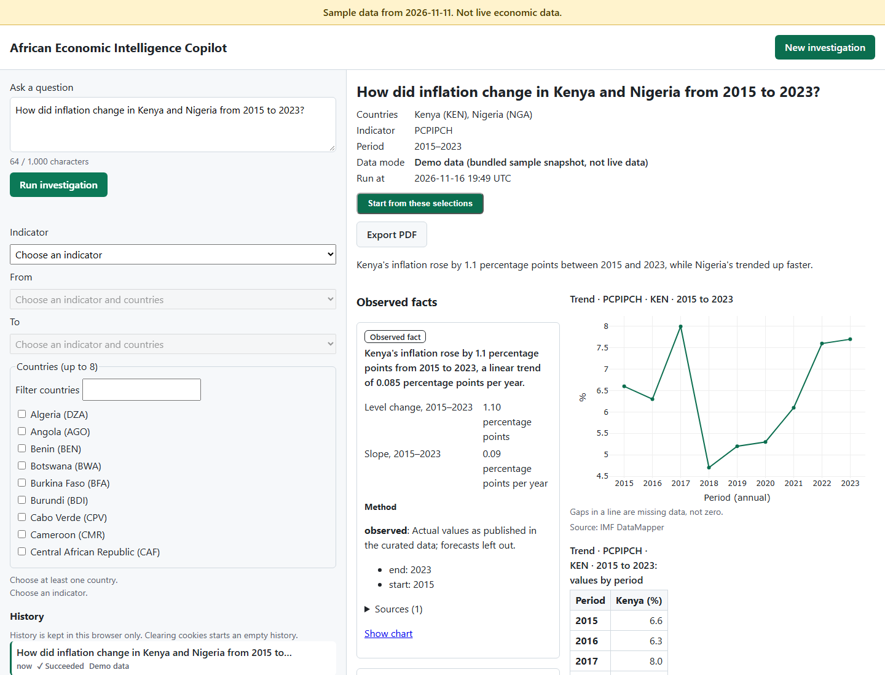
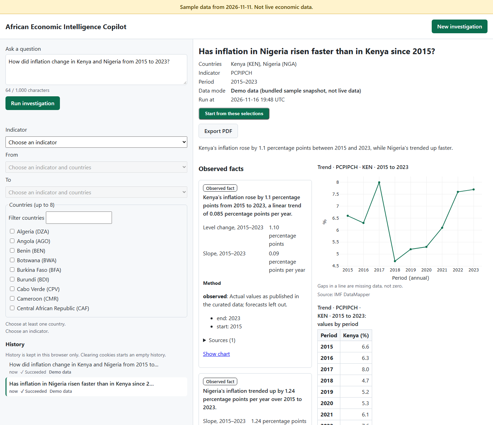
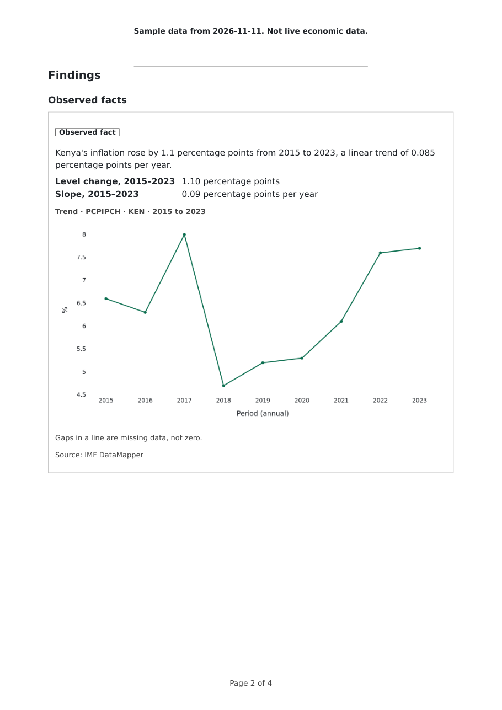
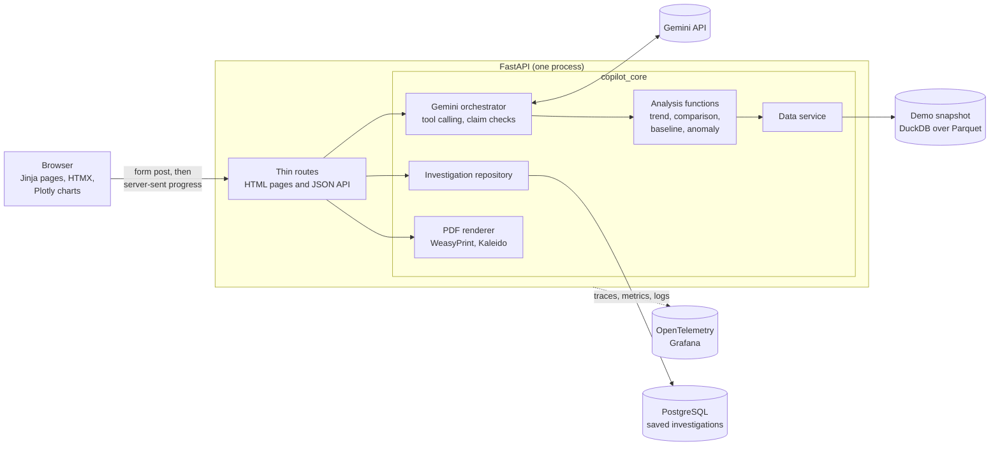

# African Economic Intelligence Copilot

[](https://github.com/Chris-Ndungu/African-Economic-Intelligence-Copilot/actions/workflows/ci.yml)
[](https://github.com/Chris-Ndungu/African-Economic-Intelligence-Copilot/actions/workflows/deploy-dev.yml)

Analysts studying African economies spend hours pulling indicators from
several sources, lining up periods and checking whether a movement is unusual
before they can explain it. This copilot does that groundwork: ask a question
or pick countries, indicators and a period, and it computes the trends,
comparisons and anomalies in Python, then has Gemini explain them, citing
only numbers it can check against the computed results.

**Try it:** <https://copilot-prod.onrender.com> (sample data; no sign-up).
It runs on free services, so expect two limits:

- The service sleeps when idle, so the first load after a pause can take up
  to a minute.
- Gemini's free tier allows only a few investigations a day. When the day's
  quota is used up, runs say "Gemini is unavailable"; try again the next day,
  or run it locally with your own key (below).



## Features

- **Ask in plain English or pick from lists.** Type a question, or choose an
  indicator, countries and a period. Both start the same investigation.
- **Numbers come from Python, not the model.** Trend and growth, country
  comparison, historical baseline and anomaly detection are deterministic
  functions in `copilot_core`. Gemini chooses which to call and interprets
  what they return.
- **Every cited number is checked.** Each number in the explanation must match
  a value a tool returned. Unmatched claims are marked unverified, and facts
  are kept apart from hypotheses.
- **Honest about limits.** Coverage gaps, forecast years and short series are
  stated as caveats. Questions the data cannot answer (forecasts, causal proof,
  countries or indicators outside the data) get a reason instead of findings.
- **Live progress.** Each step of a run streams to the page as it happens, and
  a run can be cancelled.
- **Charts and tables** for every result, drawn from the same computed values.
- **History.** Investigations are saved, listed in the sidebar and reopen
  with their results. History is private to each browser.
- **PDF reports** with findings, charts, method, sources and limitations.
- **Sample data built in.** 54 African countries and 14 indicators (GDP,
  inflation, exchange rates, interest rates, trade and more) from the IMF and
  the World Bank, snapshot of 2026-11-11. A banner on every page says so.

Not in this release: correlation and lagged-relationship analysis, live
BigQuery data for signed-in users and the SQL fallback. They are on the
[backlog](_docs/task.md).

| History | PDF report |
| --- | --- |
|  |  |

## How it works



A run is one form post. The server then streams progress events while Gemini
chooses analysis tools, Python computes the results, and Gemini writes the
interpretation. The claims are checked, the run is saved and the page shows
the findings. Design decisions are in the [product plan](_docs/plan.md#4-technical-decisions)
and [architecture](_docs/architecture.md).

**Stack:** Python 3.13, FastAPI, Jinja and HTMX (no Node or build step),
DuckDB, PostgreSQL with SQLAlchemy and Alembic, the Gemini API (`google-genai`),
Plotly, WeasyPrint, OpenTelemetry, Docker, GitHub Actions, Render and Neon.

## Run it locally

### With Docker (one command)

Requires only [Docker](https://docs.docker.com/get-docker/).

```bash
git clone https://github.com/Chris-Ndungu/African-Economic-Intelligence-Copilot.git
cd African-Economic-Intelligence-Copilot
docker compose up
```

Open <http://localhost:8000>. Compose starts Postgres, applies the
migrations and serves the app. It also starts Grafana at
<http://localhost:3000> with the traces, logs and the "Investigation health"
dashboard.

- To run investigations, Gemini needs a key: create a free one in
  [Google AI Studio](https://aistudio.google.com/apikey), copy `.env.example`
  to `.env` and set `COPILOT_GEMINI_API_KEY`. Without a key the workspace still
  loads and runs say Gemini is not configured.
- Ports 8000, 5432 and 3000 must be free.
- `docker compose down` stops it; `docker compose down -v` also deletes the database.

### Without Docker

Requires [uv](https://docs.astral.sh/uv/) (it installs Python 3.13).

```bash
uv sync
uv run uvicorn backend.main:app --reload
```

Open <http://localhost:8000>; the API docs are at <http://localhost:8000/docs>.
The workspace loads without a database or a Gemini key. Saving history needs
Postgres: see `DATABASE_URL` in [.env.example](.env.example).

## Tests

```bash
uv run pytest                 # unit and integration tests; end-to-end tests are skipped
uv run pytest -m e2e          # Playwright journeys against the Docker stack
uv run ruff check && uv run mypy
```

The end-to-end tests need Docker and, once per machine,
`uv run playwright install chromium`. They use demo data and recorded Gemini
answers, so they need no key. CI runs all of these on every pull request.

## Deployment and operations

- Every merge to `main` that passes CI is built into an image, pushed to
  GHCR, migrated and deployed to **dev** on Render, then smoke-tested and
  rolled back if the check fails.
- A `v*` tag deploys the same image to **prod**
  (<https://copilot-prod.onrender.com>) after manual approval. Dev is
  <https://copilot-dev-ze5l.onrender.com>.
- Traces, metrics and logs go to Grafana over OpenTelemetry. No question,
  key or password is ever recorded.

Details: [deployment](_docs/deployment.md).

## How it was built

The project was built by a team of AI agents with defined roles (PM, backend,
frontend, QA, ops), working from groomed GitHub issues with acceptance
criteria, one pull request per phase.

- [Product plan](_docs/plan.md): scope, decisions and acceptance criteria
- [Task board](https://github.com/Chris-Ndungu/African-Economic-Intelligence-Copilot/issues) and [backlog](_docs/task.md)
- [Agent team](_docs/agent-team.md) and [process](_docs/process.md)
- [Agent instructions](_docs/AGENTS.md): the context every agent session loads
- [Architecture](_docs/architecture.md), [API](_docs/api.md) and [data contract](_docs/data-contract.md)
- [Deployment](_docs/deployment.md)
